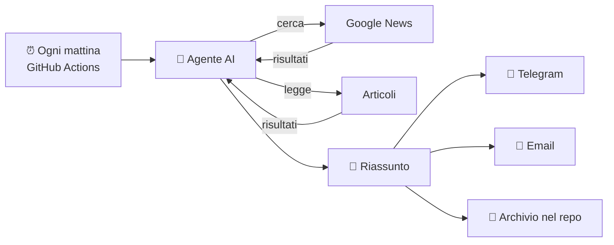

# 🗞️ News Digest Agent


Un **agente AI** che ogni mattina legge le notizie sugli argomenti che scegli, seleziona le più importanti, scrive un riassunto e te lo manda su **Telegram** o via **email**.

Gira da solo su GitHub Actions, gratis, senza server. 📂 [Guarda i notiziari già pubblicati](digests/)

## Come funziona

L'agente non segue una sequenza fissa: **decide da solo** cosa cercare, quali articoli aprire e quando ha abbastanza informazioni.



Esempio di cosa fa l'agente (`-v`):

```
🗞️  Preparo il notiziario su: intelligenza artificiale, Serie A
  🔧 search_news({"query": "intelligenza artificiale"})
  🔧 search_news({"query": "AI nuovi modelli"})
  🔧 read_article({"url": "https://..."})
  🔧 search_news({"query": "Serie A risultati"})
  [llm] risposta da groq
💾 Salvato in digests/2026-11-20.md
📬 Inviato via Telegram
```

## Caratteristiche tecniche

- **Ciclo dell'agente scritto da zero** (`agent/core.py`): nessun framework, logica chiara e leggibile
- **Function calling**: il modello sceglie fra 3 strumenti (cerca notizie, leggi feed RSS, leggi articolo)
- **Più provider AI con cambio automatico**: Groq → Gemini → OpenRouter se uno non risponde
- **Esecuzione programmata** con GitHub Actions e archivio automatico dei notiziari
- **Test senza connessione** con un'AI finta + CI

## Avvio rapido

```bash
git clone https://github.com/TUO-USERNAME/news-digest-agent.git
cd news-digest-agent
python -m venv .venv && source .venv/bin/activate   # su Windows: .venv\Scripts\activate
pip install -r requirements.txt
cp .env.example .env          # inserisci almeno una chiave AI gratuita
python main.py --dry-run -v   # prova senza inviare nulla
```

Argomenti personalizzati al volo:

```bash
python main.py --topics "Formula 1, criptovalute" --dry-run
```

## Farlo partire ogni mattina (gratis)

1. Su GitHub apri il repository → **Settings → Secrets and variables → Actions**
2. Aggiungi come *secret* le stesse chiavi del file `.env` (almeno `GROQ_API_KEY` e quelle di Telegram o email)
3. Vai nel tab **Actions** → *Notiziario quotidiano* → **Run workflow** per provarlo subito

Da quel momento parte da solo ogni giorno alle 7:00.

## Configurare Telegram

1. Su Telegram scrivi a **@BotFather** → `/newbot` → copia il token in `TELEGRAM_BOT_TOKEN`
2. Scrivi a **@userinfobot** per sapere il tuo ID → mettilo in `TELEGRAM_CHAT_ID`
3. Manda un messaggio qualsiasi al tuo nuovo bot (serve per "attivarlo")

## Test

```bash
pytest -q
```

## Idee per il futuro

- [ ] Comandi Telegram per cambiare argomenti (`/aggiungi calcio`)
- [ ] Pagina web con l'archivio dei notiziari (GitHub Pages)
- [ ] Versione audio del notiziario

## Licenza

MIT
