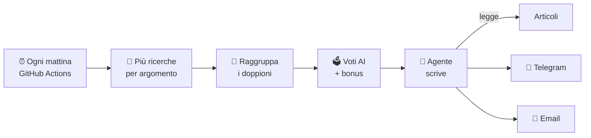

# 🗞️ News Digest Agent


Un **agente AI** che ogni mattina legge le notizie sugli argomenti che scegli, seleziona le più importanti, scrive un riassunto e te lo manda su **Telegram** o via **email**.

Gira da solo su GitHub Actions, gratis, senza server.

## Come funziona

Il lavoro è diviso come in una redazione: prima si **scelgono** le notizie, poi l'agente le **scrive**.



### Come vengono scelte le notizie

1. **Tante candidate**: per ogni argomento l'AI propone 3 ricerche diverse (es. *intelligenza artificiale*, *AI regolamentazione*, *AI etica lavoro*) e si raccolgono ~45 notizie da Google News.
2. **Niente doppioni**: i titoli che raccontano lo stesso fatto vengono uniti. Se ne parlano più giornali, la notizia è probabilmente importante.
3. **Voti**: l'AI fa da caporedattore e dà a ogni notizia un voto da 0 a 10 su
   - **importanza** (impatto concreto per un lettore italiano),
   - **novità** (fatto nuovo di oggi, non commenti, eventi promozionali o pubblicità),
   - **pertinenza** (le notizie fuori tema vengono scartate).
4. **Classifica**: `punteggio = 0,5·importanza + 0,2·novità + 0,3·pertinenza`, più **+0,5 per ogni altro giornale** che ne parla (max +2) e **+0,5 se è uscita nelle ultime 6 ore**. Una notizia già usata in un argomento non viene ripetuta in un altro.

Se la selezione non riesce, l'agente torna a cercare e scegliere da solo. Si regola in `config.toml`, nella sezione `[selezione]`.

Esempio di cosa fa (`-v`):

```
📚 intelligenza artificiale
  🔎 intelligenza artificiale
  🔎 AI regolamentazione
  🔎 AI etica lavoro
  🗳️  votate 25/25
  ✅  9.80  [1 fonti] «Ho risolto con l'intelligenza artificiale il Sacro Graal della matematica»...
  ✅  8.40  [1 fonti] Intelligenza artificiale, lavoro e partecipazione: Assolombarda e Sindacati...
  ✅  8.20  [1 fonti] Intelligenza artificiale: la relazione della Cassazione
      7.30  [2 fonti] Fari sull'intelligenza artificiale: "Nessuna paura per le imprese..."
  🔧 read_article({"id": "L5"})
📬 Inviato via Telegram
```

## Caratteristiche tecniche

- **Selezione a punteggio**: raggruppamento dei titoli simili, voti dell'AI in JSON (letti anche se la risposta arriva troncata), bonus per copertura e freschezza
- **Function calling**: il modello sceglie fra 3 strumenti (cerca notizie, leggi feed RSS, leggi articolo)
- **Più provider AI con cambio automatico**: Groq → Gemini → OpenRouter se uno non risponde
- **Esecuzione programmata** con GitHub Actions
- **Test senza connessione** con un'AI finta + CI

## Avvio rapido

```bash
git clone https://github.com/TUO-USERNAME/news-digest-agent.git
cd news-digest-agent
python -m venv .venv && source .venv/bin/activate   # su Windows: .venv\Scripts\activate
pip install -r requirements.txt
cp .env.example .env          # inserisci almeno una chiave AI gratuita
python main.py --dry-run -v   # prova senza inviare nulla
```

Argomenti personalizzati al volo:

```bash
python main.py --topics "Formula 1, criptovalute" --dry-run
```

## Farlo partire ogni mattina (gratis)

1. Su GitHub apri il repository → **Settings → Secrets and variables → Actions**
2. Aggiungi come *secret* le stesse chiavi del file `.env` (almeno `GROQ_API_KEY` e quelle di Telegram o email)
3. Vai nel tab **Actions** → *Notiziario quotidiano* → **Run workflow** per provarlo subito

Da quel momento parte da solo ogni giorno alle 7:00.

## Configurare Telegram

1. Su Telegram scrivi a **@BotFather** → `/newbot` → copia il token in `TELEGRAM_BOT_TOKEN`
2. Scrivi a **@userinfobot** per sapere il tuo ID → mettilo in `TELEGRAM_CHAT_ID`
3. Manda un messaggio qualsiasi al tuo nuovo bot (serve per "attivarlo")

## Test

```bash
pytest -q
```

## Idee per il futuro

- [ ] Comandi Telegram per cambiare argomenti (`/aggiungi calcio`)
- [ ] Versione audio del notiziario

## Licenza

MIT
